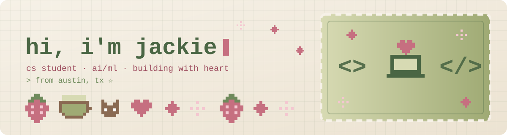

  
  
  
  
  

## 🍓 About Me

I'm Jackie Perales, a Computer Science student (AI/ML concentration, Business minor) at St. Edward's University in Austin, Class of 2027. I love building things that solve real problems for real people, with a soft spot for fashion, computer vision, and agentic AI.

Most recently I was a Software Engineering Intern at Salesforce, where I built and shipped a production Claude-powered agent that autonomously triages support tickets. I'm also a Break Through Tech AI fellow, an MLT fellow, Vice President of Women in Tech at St. Edward's, and a Resident Advisor who is slightly too into door decs.

I'm a first-gen Mexican American who cares a lot about making tech a place where more people like me feel at home. Thanks for stopping by 🌸

  
  

## 🍵 Tech Stack

- **Languages:**

  

- **AI / ML:**

  
  
  
  
  
  
  
  

- **Frameworks / Cloud:**

  

- **Design & Data Tools:**

  
  
  
  
  

- **IDEs & Workflow:**

  
  
  
  
  

## 🧸 Some Projects

### [Dresscode](https://github.com/jperal246/dresscode)

> Computer Vision semester project, Fall 2026 | *Tech Stack: Python, PyTorch, YOLOv8 / Mask R-CNN, CLIP, MediaPipe, Notion API*

- A personal AI stylist: a three-stage vision pipeline that segments and tags garments from ordinary closet photos (trained on Fashionpedia), scores which pieces work together with type-aware embeddings (Polyvore Outfits), and re-ranks outfits by your personal style, the weather, and what's on your calendar.
- Writes the day's outfit pick straight into my Notion planner, with an optional hands-free gesture module built on MediaPipe hand landmarks.

### AI Support Ticket Triage Agent

> Salesforce Software Engineering Internship, Summer 2026 | *Tech Stack: Python, Claude API, LangChain, LangGraph, MCP*

- Built and shipped a production Claude-powered agent on the Managed Packaging / Platform Org team that autonomously triages incoming support tickets, so engineers spend their time fixing issues instead of sorting them.
- Designed the agent's tool layer with MCP and orchestrated multi-step reasoning with LangGraph.

### [Contract Review & Risk Triage](https://github.com/Break-Through-Tech/Accenture-1H-contract-review-challenge)

> Break Through Tech AI Studio x Accenture, Fall 2026 | *Tech Stack: Python, Legal-BERT, Hugging Face Transformers, scikit-learn, Google Colab*

- Team project detecting legal clauses in the CUAD contract dataset and scoring contract risk with a fine-tuned transformer plus an explainable rule-based scoring layer.
- Owned the per-category TF-IDF vs. transformer F1 comparison and tackled class imbalance with weighted loss and oversampling.

### [Iglesia Emmanuel Tutoring Website](https://github.com/jperal246/emanuellearningcenter.github.io)

> Code For Change | *Tech Stack: HTML, CSS, JavaScript, PHP, SQL*

- Built a full-stack website for a local church tutoring program in collaboration with Duke University students, serving 30+ families and tutors.

## 💌 Things I Love

- Fashion and styling (yes, Dresscode started as a personal problem)
- Photography, live music, and exploring Austin and San Francisco
- Over-planning trips in Notion, complete with maps
- Puzzles and reading. Always taking book recs
- Cheering on women and first-gen students in tech

## 🌷 Contact Me!

made with matcha, strawberries, and a little too much pixel art 🍓🍵

